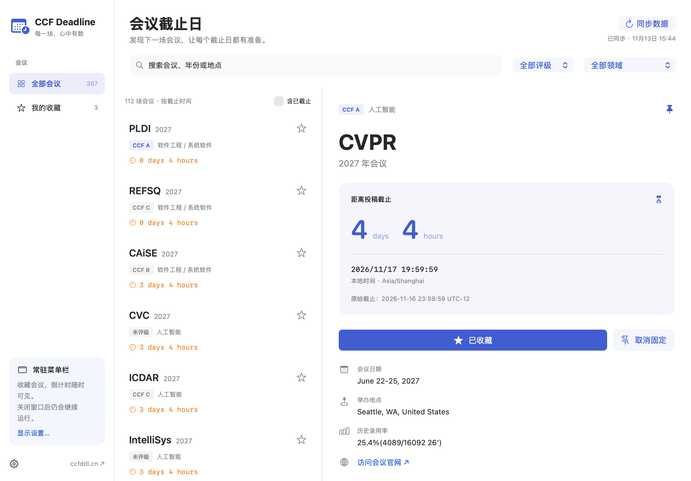

# CCF Deadline for macOS

**English** | [简体中文](README.zh-CN.md)

A native macOS conference deadline companion. Save conferences and keep their year, name, and remaining days / hours in your menu bar.

> **Acknowledgments: Thank you to [CCFDDL / ccfddl.cn](https://ccfddl.cn/), its maintainers, and its contributors for collecting and maintaining public conference deadlines. This app gets its conference data directly from that website. We also thank the upstream project linked by the website, [ccfddl/ccf-deadlines](https://github.com/ccfddl/ccf-deadlines).**
>
> This is an independent, unofficial client, not affiliated with or endorsed by CCFDDL, CCF, or conference organizers.



*The screenshot uses public conference data and demonstration favorites. The current app interface is in Chinese.*

## Download and install

Download `CCF-Deadline-macOS-universal.zip` from [GitHub Releases](https://github.com/liyizhen127/ccf-deadline-macos/releases/latest), unzip it, and move `CCF Deadline.app` to Applications.

- Requires macOS 13 Ventura or later.
- Universal binary for Apple Silicon (arm64) and Intel (x86_64). Runtime checks were performed on Apple Silicon; Intel was cross-compiled.
- Releases are **ad-hoc signed, not Apple Developer ID notarized**. If macOS blocks the app, verify its source and use **Open Anyway** in System Settings → Privacy & Security. Disabling Gatekeeper is not required.
- Download checksums are provided in the release's `SHA256SUMS` file.

## Features and usage

- Conference details, CCF ranks, research areas, venues, and deadlines from [ccfddl.cn](https://ccfddl.cn/).
- Search and filter by keyword, rank, and area; optionally include expired conferences.
- Persistent local favorites and a pinned conference of your choice.
- Menu bar modes: nearest deadline, rotation every 15 seconds, or a separate item for every favorite.
- Full countdowns such as `2027年 CVPR · 4 days 3 hours`, or compact `2027年 CVPR · 4d 3h`.
- Refresh on launch, hourly refresh, manual refresh, and offline caching.
- Continues running after closing the window; optional launch at login.

Click ☆ beside a conference to save it. Use “固定到菜单栏” in its details to pin it. Click the menu bar item to view favorites, change the display mode, or quit. “Show all” may exceed available menu bar space, especially on a notched display; rotation or compact mode uses less space. Launch at login may require approval in macOS Login Items settings.

## Data and time handling

The app reads conference literals from the public `https://ccfddl.cn/` page and **never executes its JavaScript**. It does not rely on a separate JSON API; if the website changes its structure, the parser may need updating. A failed refresh displays an error and preserves the last successful cache.

The initial offline snapshot contains 386 public conference records fetched on 2026-11-13. The app shows when data was updated; the count may change after synchronization.

- `AoE` means UTC−12. Explicit UTC offsets remain fixed.
- `PT` follows Los Angeles daylight saving time **on the deadline date**, not today's offset.
- Both local and original deadlines / time zones are displayed.
- Days / hours round down. Less than one hour and expired deadlines have distinct labels.
- Automatic selection prefers future deadlines, then unknown dates, then the most recently expired deadline. Pinning keeps the selected conference visible.
- Favorites refer to a specific yearly edition. A new edition never silently replaces a saved one. Removed source records are retained with their previous data and an archival notice.

Deadlines may change. **The conference's official website is the final authority.**

## Privacy

- Favorites and settings stay on your Mac, separate from website browser favorites. No browser access, favorite uploads, account login, analytics, or telemetry.
- Normal synchronization sends a GET request to `https://ccfddl.cn/` and follows its redirects. Clicking a conference link opens it in the default browser.
- Local files: `~/Library/Application Support/CCFDeadline/preferences.json` and `conferences.json`. Writes use atomic replacement.
- Published source and releases exclude personal favorites, caches, private email addresses, signing credentials, access tokens, and local username paths. Builds remove debug metadata, remap source paths, and audit the app bundle. This check is not a comprehensive security audit.

## Build and test

Requires Xcode, or Swift 5.9+ with the macOS SDK, and Python 3 for the release audit. There are no third-party Swift package dependencies.

```bash
git clone https://github.com/liyizhen127/ccf-deadline-macos.git
cd ccf-deadline-macos
bash scripts/build-app.sh
open "dist/CCF Deadline.app"
swift test
python3 scripts/audit-release.py "dist/CCF Deadline.app"
```

The default output is `dist/CCF Deadline.app`. Set `BUILD_DIR` and `OUTPUT_DIR` to customize locations. The script compiles both architectures, merges them, removes debug metadata, performs a privacy audit, and applies an ad-hoc signature.

13 core tests cover time zones / DST, deadline boundaries, safe parsing, yearly favorites, ordering, pinning, rotation, and serialization. An isolated smoke test verifies real menu bar items, persistence, offline fallback, and live sync, then exports a screenshot:

```bash
curl -fL https://ccfddl.cn/ -o /tmp/ccfddl.html
TEST_DIR="$(mktemp -d /tmp/ccf-deadline-test.XXXXXX)"
"dist/CCF Deadline.app/Contents/MacOS/CCFDeadline" \
  --smoke-test /tmp/ccfddl.html /tmp/ccf-preview.png "$TEST_DIR" --live
```

The test does not modify normal app favorites. Use `--validate-html /tmp/ccfddl.html` for parser-only validation.

## Project structure

| Path | Purpose |
| --- | --- |
| `Sources/DeadlineCore` | Models, time zones, safe parser, and menu bar selection |
| `Sources/CCFDeadline` | SwiftUI window, AppKit menu bar, sync, and storage |
| `Tests/DeadlineCoreTests` | Core tests |
| `scripts/build-app.sh` | Universal app build, cleanup, and signing |
| `scripts/audit-release.py` | Privacy checks for source, app bundles, and ZIPs |
| `Sources/CCFDeadline/Resources/seed.json` | Public conference snapshot |

## License and credits

Client code uses the [MIT License](LICENSE). Upstream CCFDDL licensing and attribution are retained in [THIRD_PARTY_NOTICES.txt](THIRD_PARTY_NOTICES.txt), also shipped in the app.

Thank you again to **[ccfddl.cn](https://ccfddl.cn/)** and its contributors. Credit for maintaining the conference data belongs to the original website and community; this project adds the native macOS interface and menu bar experience.
