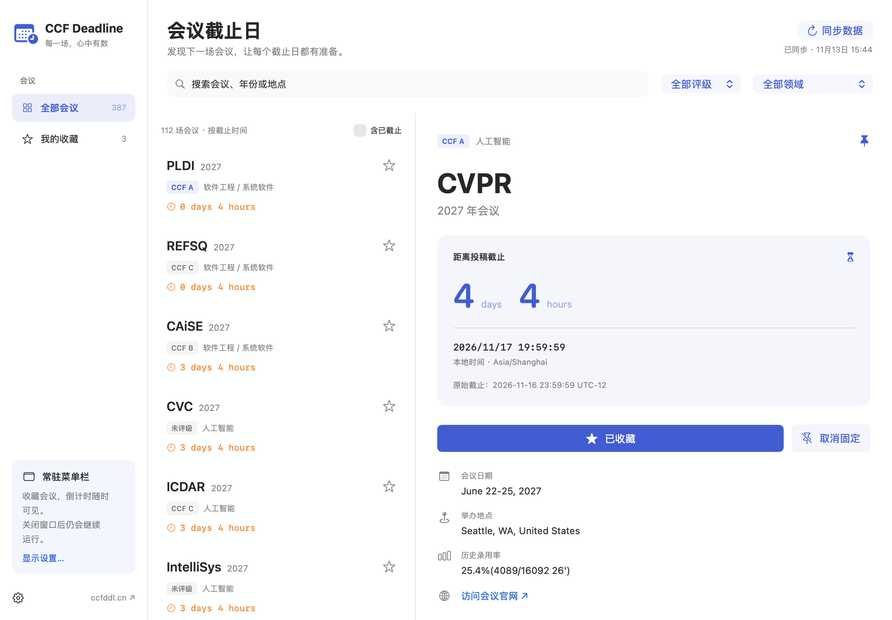

# CCF Deadline for macOS

[English](README.md) | **简体中文**

原生 macOS 会议截止日工具。收藏你关注的会议，将「年份 · 会议名称 · 剩余天数 / 小时」放在菜单栏。

> **致谢：衷心感谢 [CCFDDL / ccfddl.cn](https://ccfddl.cn/) 及其维护者、贡献者持续整理和维护公开的会议截止信息。这个 App 的会议数据直接来自该网站。也感谢网站链接的上游项目 [ccfddl/ccf-deadlines](https://github.com/ccfddl/ccf-deadlines)。**
>
> 这是独立开发的非官方客户端，与 CCFDDL、CCF 或会议主办方没有隶属或背书关系。



*截图使用公开会议数据，其中的收藏仅用于演示。当前 App 界面为中文。*

## 下载与安装

从 [GitHub Releases](https://github.com/liyizhen127/ccf-deadline-macos/releases/latest) 下载 `CCF-Deadline-macOS-universal.zip`，解压，将 `CCF Deadline.app` 拖入“应用程序”后打开。

- macOS 13 Ventura 及以上。
- Universal 二进制，包含 Apple Silicon（arm64）和 Intel（x86_64）。运行验证在 Apple Silicon 上完成，Intel 为交叉编译。
- Release 为本地 ad-hoc 签名，**未经过 Apple Developer ID 公证**。如果 macOS 阻止打开，确认来源后，在“系统设置 → 隐私与安全性”选择“仍要打开”。无需关闭 Gatekeeper。
- 同一 Release 的 `SHA256SUMS` 文件可用于验证下载文件。

## 功能与使用

- 同步 [ccfddl.cn](https://ccfddl.cn/) 的会议、年份、CCF 评级、领域、地点、截止日期与时区。
- 按关键词、评级、领域搜索筛选；默认隐藏已截止会议，可手动显示。
- 本机收藏持久保存，可固定某一场会议。
- 菜单栏三种模式：最近截止、每 15 秒轮播、全部收藏分别显示。
- 完整倒计时 `2027年 CVPR · 4 days 3 hours`，或精简格式 `2027年 CVPR · 4d 3h`。
- 启动同步、每小时自动同步、手动刷新与离线缓存。
- 关闭窗口后继续运行，可选登录 Mac 时启动。

在会议旁点击 ☆ 收藏，即可在菜单栏看到倒计时。会议详情中的“固定到菜单栏”可固定某场会议。点击菜单栏项目可查看收藏、切换模式或退出。“全部显示”可能受屏幕宽度和刘海区域限制，空间紧张时建议选择轮播或精简格式。登录启动可能需要在系统设置的登录项中允许。

## 数据来源与时间规则

App 直接读取 `https://ccfddl.cn/` 公开页面中的会议字面量，**不执行网站 JavaScript**。目前不依赖独立 JSON API；如果网站结构变化，解析器可能需要更新。同步失败时显示错误并保留上次数据。

首次离线启动使用 2026-11-13 抓取的 386 条公开会议快照。界面显示数据更新时间，会议数量会随同步变化。

- `AoE` 为 UTC−12；明确指定的 UTC 偏移按固定值处理。
- `PT` 根据**截止日期**的洛杉矶夏令时计算，而非根据今天的偏移。
- 同时展示本地时间、原始截止时间与原始时区。
- 剩余天数 / 小时向下取整，不足一小时和已截止状态单独提示。
- 自动显示优先级为未截止、待定、最近已截止；固定模式始终显示所选会议。
- 收藏绑定具体年份，新一届不会悄悄替换旧收藏。移出源站列表的收藏会保留上次数据并注明。

会议日期可能变化，**最终以会议官网为准**。

## 隐私

- 收藏和偏好只保存在本机，与网站浏览器收藏独立。不读取浏览器，不上传收藏，没有账号登录、统计或遥测。
- 正常同步仅向 `https://ccfddl.cn/` 发送 GET 请求并跟随网站重定向；点击会议官网链接时才由默认浏览器打开。
- 本地文件为 `~/Library/Application Support/CCFDeadline/` 下的 `preferences.json` 和 `conferences.json`，写入采用原子替换。
- 发布源码和 Release 不包含个人收藏、缓存、私人邮箱、签名凭据、访问令牌或本机用户名路径。构建过程清理调试信息、映射源码路径并检查安装包。隐私检查不等同于完整安全审计。

## 构建与测试

需要 Xcode，或包含 macOS SDK 的 Swift 5.9+ 工具链，以及用于发布检查的 Python 3。没有第三方 Swift 包依赖。

```bash
git clone https://github.com/liyizhen127/ccf-deadline-macos.git
cd ccf-deadline-macos
bash scripts/build-app.sh
open "dist/CCF Deadline.app"
swift test
python3 scripts/audit-release.py "dist/CCF Deadline.app"
```

默认输出 `dist/CCF Deadline.app`。可通过 `BUILD_DIR` 和 `OUTPUT_DIR` 指定目录。脚本编译两个架构、合并、清理调试信息、进行隐私检查，最后本地签名。

13 项核心测试覆盖时区 / 夏令时、截止边界、安全解析、年份收藏、排序、固定、轮播与序列化。独立目录冒烟测试检查真实菜单栏、持久保存、断网缓存、联网同步，并输出窗口截图：

```bash
curl -fL https://ccfddl.cn/ -o /tmp/ccfddl.html
TEST_DIR="$(mktemp -d /tmp/ccf-deadline-test.XXXXXX)"
"dist/CCF Deadline.app/Contents/MacOS/CCFDeadline" \
  --smoke-test /tmp/ccfddl.html /tmp/ccf-preview.png "$TEST_DIR" --live
```

测试不会修改正式 App 收藏。仅验证网站解析时可使用 `--validate-html /tmp/ccfddl.html`。

## 项目结构

| 路径 | 用途 |
| --- | --- |
| `Sources/DeadlineCore` | 模型、时区、安全解析与菜单栏选择逻辑 |
| `Sources/CCFDeadline` | SwiftUI 窗口、AppKit 菜单栏、同步和本机存储 |
| `Tests/DeadlineCoreTests` | 核心测试 |
| `scripts/build-app.sh` | Universal App 构建、清理与签名 |
| `scripts/audit-release.py` | 源码、App、ZIP 的隐私检查 |
| `Sources/CCFDeadline/Resources/seed.json` | 公开会议离线快照 |

## 许可证与再次致谢

客户端代码采用 [MIT License](LICENSE)。CCFDDL 上游许可及来源说明保存在 [THIRD_PARTY_NOTICES.txt](THIRD_PARTY_NOTICES.txt)，并随 App 分发。

再次感谢 **[ccfddl.cn](https://ccfddl.cn/)** 及其贡献者。会议数据维护的功劳属于原网站和社区；本项目提供原生 macOS 界面与菜单栏体验。
